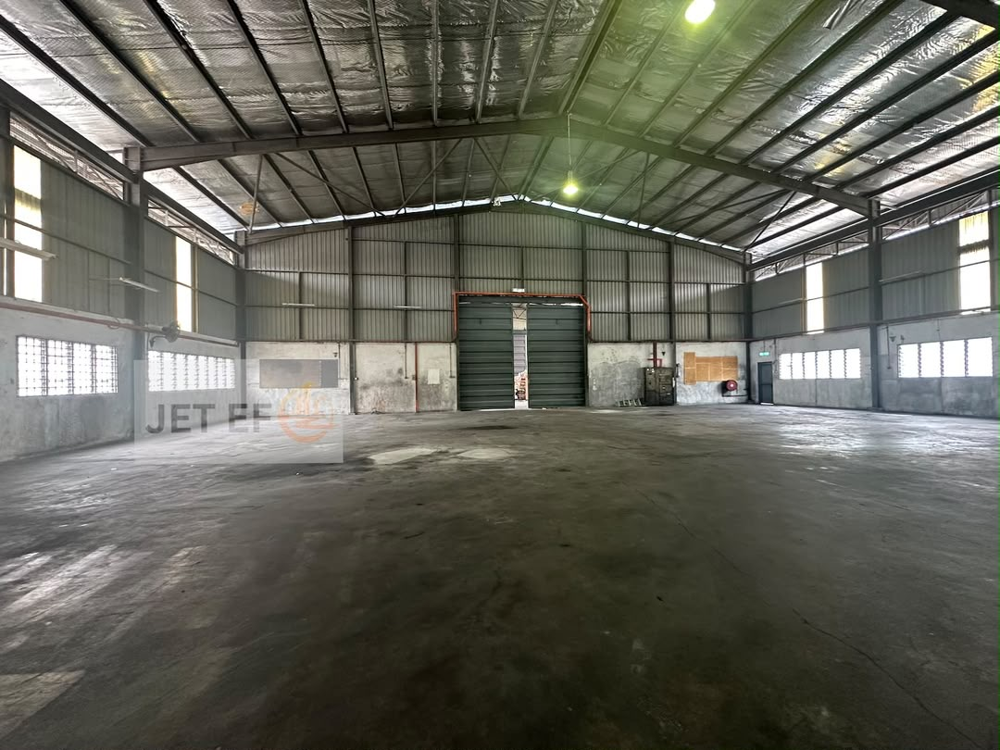

# Taffy Lim (REN 11160)
### 🏆 Klang Valley Industrial & Land Specialist | The Roof Realty Sdn Bhd

专营巴生及雪州区域：工业地产（工厂/仓库/工业地）及商业店面买卖与租赁。提供一站式专业房地产咨询，欢迎业主委托与客户垂询！

---

## ⚡ FEATURED HOT LISTING / 首席主推房源 ⚡

### 🏭 Taman Sentosa Shared Single Storey Warehouse (For Storage Only)
**📍 Location:** Taman Sentosa, Klang, Selangor
**📅 Availability:** Dec 2026 (Secure Your Space Early! / 欢迎提前预订)

### 📐 Property Specifications / 厂房规格：
* **Total Built-up Area:** Approx. 9,600 sqft (Dimension: 80' x 120') / 建筑面积 9,600 平方尺
* **Ceiling Eaves Height:** 30 feet (Excellent for high-racking setup!) / 30尺高挑高（利于高位货架）
* **Power Supply:** 3-Phase 200 Amp / 电力供应 200 安培
* **Compliance:** Fully equipped **WITH CF / CCC** (Safe & legal corporate setup) / 备有合法入伙证
* **Security:** Gated & Guarded compound / 围墙管理与保安看守
* **Logistics:** Spacious outdoor compound for easy truck loading/unloading container access. / 门口路面宽敞，方便大卡车进出卸货。
* **Accessibility:** Fast access to KESAS Highway, Federal Highway, and direct connectivity to Port Klang. / 快速连接 KESAS 大道及巴生港口。

### 💰 Monthly Rental / 租金只需: RM 17,000 / month (Negotiable)

---

## 📞 Contact Me Directly / 立即联络我
Click the link below to chat with me instantly via WhatsApp for viewing arrangements or owner listings:

👉 [🟢 CLICK HERE TO WHATSAPP TAFFY LIM (017-3751728)](https://wa.me)

---
🌐 *Registered Industrial Specialist Agent. Your trusted partner for corporate setup in Klang.*
---

## 📋 Submit Your Requirement / 提交您的精准找房找地需求
If you are looking for specific factories, warehouses, or land, please fill up the form below. I will filtering the market and contact you within 24 hours.

<form action="https://formspree.io" method="POST" style="background:#f9f9f9; padding:20px; border-radius:8px; border:1px solid #ddd; max-width:600px;">
  

    <label style="display:block; font-weight:bold; margin-bottom:4px;">1. Company & Contact Name / 公司与联络人姓名 *</label>
    <input type="text" name="name" required style="width:100%; padding:8px; border:1px solid #ccc; border-radius:4px;">
  

  
  

    <label style="display:block; font-weight:bold; margin-bottom:4px;">2. Contact Number / 电话号码 *</label>
    <input type="tel" name="phone" required style="width:100%; padding:8px; border:1px solid #ccc; border-radius:4px;">
  

  

    <label style="display:block; font-weight:bold; margin-bottom:4px;">3. Intent / 意向 *</label>
    <select name="intent" style="width:100%; padding:8px; border:1px solid #ccc; border-radius:4px;">
      <option value="Rent">Rent / 出租</option>
      <option value="Buy">Buy / 购买</option>
    </select>
  

  

    <label style="display:block; font-weight:bold; margin-bottom:4px;">4. Property Type / 物业类型 *</label>
    <select name="type" style="width:100%; padding:8px; border:1px solid #ccc; border-radius:4px;">
      <option value="Detached Factory">Detached Factory / 独立厂房</option>
      <option value="Semi-D Factory">Semi-D Factory / 半独立厂房</option>
      <option value="Warehouse">Warehouse / 仓库</option>
      <option value="Industrial Land">Industrial Land / 工业地</option>
    </select>
  

  

    <label style="display:block; font-weight:bold; margin-bottom:4px;">5. Target Area / 目标区域 (e.g. Kapar, Telok Gong) *</label>
    <input type="text" name="location" required style="width:100%; padding:8px; border:1px solid #ccc; border-radius:4px;">
  

  

    <label style="display:block; font-weight:bold; margin-bottom:4px;">6. Min Built-up Area / 最少建筑面积 (sqft)</label>
    <input type="text" name="size" style="width:100%; padding:8px; border:1px solid #ccc; border-radius:4px;" placeholder="e.g. 20,000 sqft">
  

  

    <label style="display:block; font-weight:bold; margin-bottom:4px;">7. Power Supply / 电力需求 (Amp)</label>
    <input type="text" name="power" style="width:100%; padding:8px; border:1px solid #ccc; border-radius:4px;" placeholder="e.g. 3-Phase 400 Amp / 1200 Amp">
  

  

    <label style="display:block; font-weight:bold; margin-bottom:4px;">8. CF / CCC Requirement / 入伙证要求 *</label>
    <select name="cf" style="width:100%; padding:8px; border:1px solid #ccc; border-radius:4px;">
      <option value="Must with CF">Must with CF / 必须备有合法入伙证</option>
      <option value="No CF OK">No CF OK / 无入伙证可以接受</option>
    </select>
  

  

    <label style="display:block; font-weight:bold; margin-bottom:4px;">9. Target Budget (RM) / 预算范围 *</label>
    <input type="text" name="budget" required style="width:100%; padding:8px; border:1px solid #ccc; border-radius:4px;" placeholder="e.g. RM 30k/month or RM 15 Million">
  

  <button type="submit" style="background:#2ecc71; color:white; border:none; padding:12px 20px; font-size:16px; font-weight:bold; border-radius:4px; cursor:pointer; width:100%;">🚀 SUBMIT REQUIREMENT / 提交找房申请</button>
</form>
